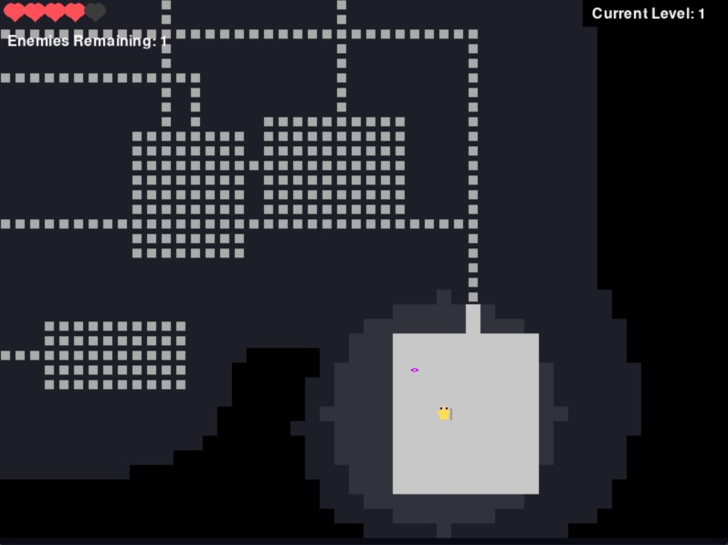

# FogBound
 
A procedural dungeon crawler built with Python and Pygame. Play as a mage, explore a dungeon that only reveals itself as you move, and blast your way through waves of enemies with particle-based magic.
 

 
**Authors:** Kaitlyn Walker
**Originally developed:** November 2025
 
---
 
## Features
 
- **Procedural dungeons:** every run generates a new map of randomly sized rooms joined by corridors.
- **Fog of war:** you only see tiles near you, and areas you have already explored stay marked on the minimap.
- **Wave-based combat:** fight waves of enemies that scale with the difficulty you choose.
- **Magic attacks:** press the spacebar to fire a burst of magic particles in every direction.
- **Power-ups:** pick them up by walking over them to gain advantages like shields.
- **Home screen:** choose the difficulty and the number of levels/waves before you start.
## Gameplay
 
Fogbound is a dungeon crawler where the player uses magic to defeat waves of enemies. Enemies wander the dungeon and chase you once you are within their vision range. Defeat every wave to finish the game.
 
| Action | Control |
| Movement | WASD, Arrow Keys |
| Attack | `Space` |
| Pick up a power-up | Walk over it |
 
## Getting Started
 
### Prerequisites
 
- Python 3.x
- [uv](https://docs.astral.sh/uv/) package manager
### Installation
 
```bash
git clone https://github.com/katie-sol/FogBound.git
cd FogBound
uv pip install pygame
```
 
### Running the game
 
```bash
uv run src/main.py
```
